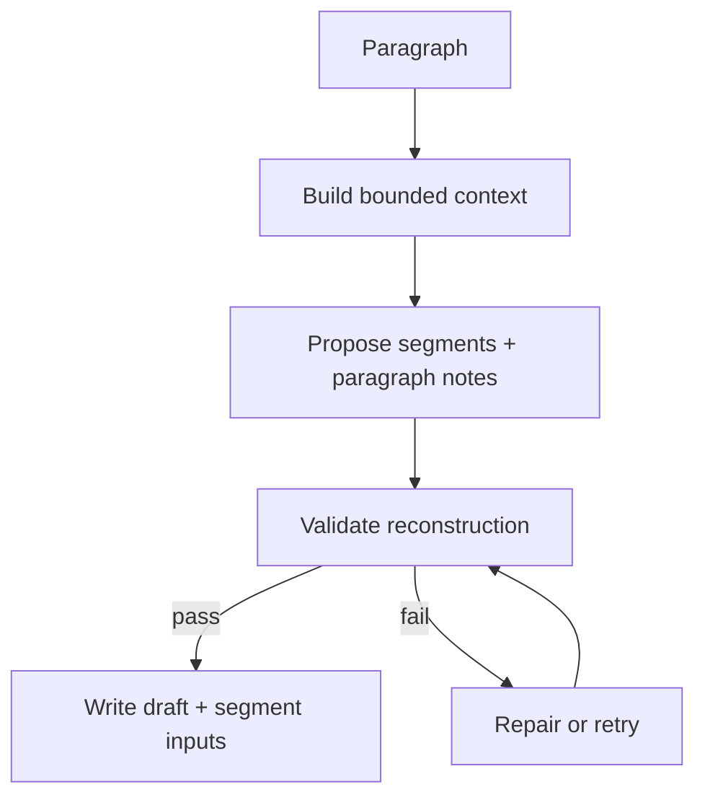
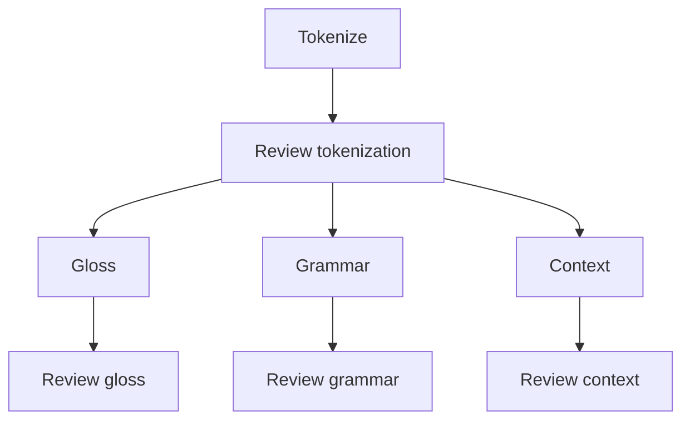

# Proposal: Job Execution

**Status:** proposed. Current runner: [Jobs and LLM](../architecture/jobs-and-llm.md). Backlog: F7, G-W1, G-W3, G-W4, G-C5.

Make preprocessing jobs context-aware, concurrent, rate-limit safe, and fully auditable, while keeping the segment as the unit of resumability.

## Bounded context

Each call gets the smallest context that supports a correct local decision. Never send the whole document to a paragraph or segment job.

| Job | Context |
|---|---|
| Paragraph structure (`split-segments`) | Current paragraph; a small window of neighboring paragraphs; chapter title and summary; known entities and recurring terms from earlier paragraphs; source snippets for paragraph-level context notes |
| Segment jobs | Segment text; `localContext` (paragraph summary, previous and next segment); candidate glosses; source snippets when grounding is needed |

For large documents, generate a chapter summary when splitting paragraphs and keep rolling indexes so local jobs stay informed:

```text
structure/chapters/<chapter-id>/summary.json
indexes/entity-index.json
indexes/term-index.json
```

```json
{
  "documentId": "…", "chapterId": "…", "model": "…", "promptVersion": "chapter-summary-v1",
  "summary": "Brief summary of the chapter's argument, people, and setting.",
  "entities": [{"surface": "曹操", "description": "Central political and military figure."}],
  "terms": [{"surface": "詔", "description": "Imperial command or edict."}]
}
```

## Flows

Paragraph structure validates before writing and repairs on failure:



Segment components fan out after tokenization review: gloss, grammar, and context drafting run **in parallel**, each followed by its own review.



A paragraph is complete when every segment's components have succeeded **or been intentionally blocked** by the editor.

## Concurrency and rate limits

- Run segment components on an `asyncio` worker pool with async httpx, capped by `concurrency.default` or `--concurrency <n>`.
- Run paragraph structure jobs before the segment jobs in that paragraph.
- Retry transient provider failures with backoff; slow down or pause when tokens-per-minute limits are reached.
- Prefer many small resumable calls over a few large ones.
- `--continue-on-blocked` keeps a batch going past a blocked unit.
- `--dry-run` lists what would run without calling the model.

## Job metadata

Each output artifact records:

| Field | Purpose |
|---|---|
| ids for its scope | document, chapter, paragraph, segment |
| `jobKind` | e.g. `gloss-segment` |
| `inputHash` | skip and staleness |
| `promptVersion` | invalidate on prompt change (branded `PromptVersion` id type) |
| `model`, model settings | audit; compare outputs across models |
| `attempts` | real count, incremented across reruns |

This lets the pipeline resume after interruption, reprocess only changed components, cache successful outputs, and compare outputs when prompts or models change.

## Failures and blocking

- Catch provider and parse errors as `JobFailure` instead of tracebacks.
- Keep raw failed responses and diagnostics under `jobs/<scope>/<id>/raw-llm/` or a failure report that status never counts as complete.
- On review rejection: write the review, exit non-zero, block the component. The editor reruns after fixing inputs or deleting artifacts.
- After repeated failure, mark the **smallest** affected unit blocked (one component rather than the whole segment or paragraph) instead of accepting bad content.
