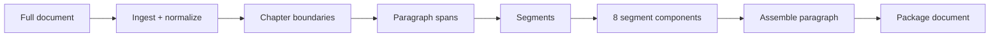

# Pipeline

> **Spec** — what each preprocessing stage does today, at what scope, and who decides (LLM, code, or editor + agent skill). Commands: [CLI](cli.md). Files: [Artifacts](artifacts.md). Planned changes live in the [backlog](../backlog.md).

A source is always a full document. The pipeline splits it into chapters → paragraphs → segments, then runs eight components per segment, assembles paragraphs, and packages the document for the reader.



## Stages

| Stage | Scope | Decided by | Command | Prompt |
|---|---|---|---|---|
| Ingest + normalize | document | code | `ingest-document` | — |
| Chapter boundaries | document | editor + agent | [preparing-source-structure](../../.opencode/skills/preparing-source-structure/SKILL.md) skill | — |
| Paragraph spans | chapter | LLM, validated by code | `split-paragraphs` | `paragraph-structure.md` |
| Segments | paragraph | LLM | `split-segments` | `paragraph-segmentation.md` |
| Tokenization | segment | LLM, punctuation dropped by code | `tokenize-segment` | `segment-tokenization.md` |
| Gloss selection | segment | LLM, deduped by code | `gloss-segment` | `segment-gloss.md` |
| Grammar notes | segment | LLM, normalized by code | `annotate-segment-grammar` | `segment-grammar.md` |
| Context notes | segment | editor + agent (web research) | [drafting-context-notes](../../.opencode/skills/drafting-context-notes/SKILL.md) skill | — |
| Reviews (tokenization, gloss, grammar) | segment | LLM | `review-segment-*` | `segment-*-review.md` |
| Context review | segment | editor + agent | [reviewing-context-notes](../../.opencode/skills/reviewing-context-notes/SKILL.md) skill | — |
| Assembly | paragraph | code | `assemble-paragraph` | — |
| Packaging | document | code | `package-document` | — |

Prompts live in `prompts/`. `segment-context*.md` prompts exist but are unused while context jobs are stubs.

Deterministic code owns: normalization, document ids, hashes, span checks, punctuation filtering, gloss dedup, note normalization, assembly, packaging, and status. The LLM mints chapter-internal ids (paragraphs, segments, tokens, notes, glosses).

## Ingest and normalize

- Strict UTF-8 decode; CRLF/CR → LF; trailing newline ensured.
- Text is otherwise preserved exactly. `document.yaml` normalization and punctuation policies are recorded, not applied.
- Assigns a document UUID and computes source and normalized hashes.

## Chapter boundaries

The editor and agent agree on boundaries interactively and write `chapter-proposal.json` plus its validation file by hand. Source headings are used as evidence by the agent; no CLI command or LLM job is involved. `split-paragraphs` does not check the chapter validation file.

## Paragraph spans

The model receives the full chapter text and proposes paragraph spans. Code checks that spans are contiguous, non-overlapping, and cover the chapter from start to end (spans are sorted first, so order is not enforced). Ids are re-minted on every run.

## Segments

The model splits one paragraph into reader segments:

- Usually one full sentence per segment.
- Combine consecutive very short sentences; split very long sentences (~48+ characters) at clause boundaries.
- Do not split on commas alone.

It may also emit paragraph-level context notes anchored to segment ids. No reconstruction check runs at this stage; segment text is checked against the draft only at assembly.

Once segments exist, each becomes the resumable container for eight components:

```text
tokenize → review tokenization ┬→ gloss   → review gloss
                               ├→ grammar → review grammar
                               └→ context → review context   (skills)
```

Gloss and grammar require an approved tokenization review. `run` executes components sequentially in this order.

## Tokenization

Identify glossable units. Punctuation and whitespace stay in the text but are never tokens.

- Default to one character per token.
- Use multi-character tokens only for names, titles, places (`孫子`), fixed compounds whose sense is not the sum of parts (`大事`, `死生`), and set phrases in context.
- Do not merge across `之` or similar particles (`國/之/大事`).

Rules are enforced by the prompt; code only drops punctuation tokens. Offsets are not checked against the text.

## Gloss selection

For each token, the model either reuses a document gloss (`reuse-existing`) or proposes a new sense (`create-new`) with surface, pinyin, and English gloss. Distinct senses of one surface get distinct entries.

Candidates are the glossary draft plus glosses from earlier approved segments, filtered to surfaces present in the segment. After the call, code rewrites candidate hits to `reuse-existing` and merges duplicate new entries.

On approved gloss review, new glosses are merged into `indexes/glossary-draft.json`, which becomes the reader gloss index.

## Grammar notes

Segment-scoped notes on salient Classical Chinese constructions, anchored to token ids. Written only when useful to comprehension. No sources.

## Context notes

Segment-local notes on people, places, historical setting, literary references, and interpretation an English-speaking learner is unlikely to know. Drafted and reviewed with agent skills because they need web research and citations. Rules: [Quality Gates — Context notes](quality-gates.md#context-notes).

## Reviews

Each LLM review sees the draft it reviews plus the segment text (gloss review also gets candidates; grammar review also gets glosses). It returns `approved` or `rejected` with findings. Rejection blocks the component until the editor reruns or deletes artifacts. Details: [Quality Gates](quality-gates.md).

## Assembly and packaging

`assemble-paragraph` joins the paragraph draft with each segment's tokenization, glosses, grammar notes, and context notes into the [reader paragraph shape](reader-package.md#paragraph-file), validates it, and stages it under `jobs/assembly/`. `package-document` promotes all current, passed paragraphs to `content/` with the document manifest, chapter files, and gloss index. Neither calls an LLM.

## Model use

One configured provider and model serve every LLM job, drafts and reviews alike. Providers: `mock` (default, fixtures), `anthropic`, and `minimax`. Configuration: [Model Strategy](../architecture/model-strategy.md).

Each call sends the paragraph or segment it operates on, never the whole document (`split-paragraphs` sends one chapter).
